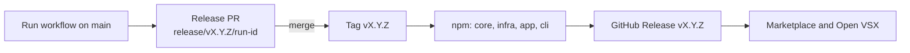

# Release Process

## Versioning

[Semantic Versioning](https://semver.org/):
- **MAJOR** — Breaking changes
- **MINOR** — New features (backward compatible)
- **PATCH** — Bug fixes (backward compatible)

`@ai-primitives-hub/core`, `infra`, `app`, `cli` and the VS Code extension
share one version and are released together
([ADR-0011](./architecture/adr/0011-one-shared-version-for-packages-and-extension.md)).
`@prompt-registry/collection-scripts` in `lib/` keeps its own version.

- The version on `main` is always `major.minor.patch`. The VS Code
  Marketplace rejects prerelease suffixes, so prereleases are npm-only.
- `apps/vscode-extension/templates/scaffolds/github/package.template.json`
  depends on `@ai-primitives-hub/cli` `^<shared version>`.
- Each release is tagged once, as `v<version>`.

CI enforces the first two rules. Run the same check locally:

```bash
pnpm run version:check   # check the five package.json files and the scaffold range
pnpm run test:scripts    # test the version scripts
```

Never edit the versions by hand. The release workflow bumps them with
`scripts/set-version.mjs`.

## Releasing

Use the **Release AI Primitives Hub** workflow (`packages-release.yml`) in
GitHub Actions. It releases everything in two reviewable stages instead of
changing `main` directly.



### 1. Prepare a release pull request

Run the workflow from the `main` branch and choose:

| Input | Values | Purpose |
| --- | --- | --- |
| `release_type` | `patch`, `minor`, `major` | Semantic version bump to apply. |
| `prerelease` | Boolean | Publish an npm-only prerelease instead; see [Prereleases](#prereleases). |
| `preid` | For example, `alpha` | Prerelease identifier; prerelease only. |
| `npm_tag` | `next`, `alpha`, `beta` | npm distribution tag; prerelease only. Stable releases always use `latest`. |
| `dry_run` | Boolean | Validate and build without publishing, pushing a branch or opening a pull request. |
| `skip_checks` | Boolean | Skip lint and tests; the release build still runs. |

The prepare job:

1. Installs Node.js 24 and the pnpm version declared by the root
   `package.json` `packageManager` field.
2. Runs `scripts/set-version.mjs`, which bumps the five `package.json` files
   and the scaffold template's CLI range, then updates `pnpm-lock.yaml`.
3. Builds core, infra, app and cli and their workspace dependencies once so all
   package declarations are available to type-aware linting, checks that the
   built CLI reports the new version, then runs lint and tests unless
   `skip_checks` is enabled.
4. Uploads the resulting `dist` directories and a release manifest as a
   workflow artifact.
5. Creates and pushes a branch named `release/v<version>/<workflow-run-id>`,
   then opens a pull request into `main`.

The build must precede linting on a clean checkout: package metadata points to
generated declarations under ignored `dist` directories. A previous local build
can hide this requirement by leaving those declarations on disk.

The CLI version is read from `packages/cli/package.json`; never hardcode it in
source.

Review the version and lockfile changes in the pull request. The generated
release branch and pull request make the version change auditable and allow
the normal repository checks to run before publication.

### 2. Merge and publish

Merging the release pull request into `main` triggers the publication stage. It
first checks that the merged packages share the release branch's version, then
downloads the build artifact from the originating prepare run and verifies:

- The version and originating workflow run agree with the manifest.
- The artifact was built from the exact pull request head commit.
- The merged package names and versions match the validated artifact.
- Each expected build output is present.

After verification, the workflow:

1. Copies the validated `dist` output into the merged checkout and installs
   dependencies with lifecycle scripts disabled.
2. Creates the `v<version>` tag on the merge commit.
3. Publishes core, infra, app and cli to npm under `latest`, without
   rebuilding.
4. Creates the `v<version>` GitHub Release with generated notes.
5. Calls the **Publishing** workflow (`vscode-extension-secure-publish.yml`)
   for that tag. It checks that the tag matches
   `apps/vscode-extension/package.json`, audits and scans the extension,
   packages it, generates SLSA provenance, publishes to the VS Code Marketplace
   and Open VSX, and attaches the installation bundle to the release.

The Publishing workflow is called directly because a release created with the
workflow's `GITHUB_TOKEN` does not trigger other workflows.

npm publication uses npm trusted publishing with provenance. Configure a
GitHub Actions trusted publisher separately for each package on npmjs.com,
using the repository owner and name that match the package metadata, the
workflow filename `packages-release.yml`, and the `npmjs` environment when
restricting the publisher to this workflow. Allow the `npm publish` action.
Keep the workflow file name: renaming it breaks trusted publishing.

The publish job intentionally does not configure `registry-url` or a
long-lived `NODE_AUTH_TOKEN`; npm OIDC authentication supplies the temporary
publish credential. Extension publication needs the `VSCODE_MARKETPLACE_TOKEN`
and `OPEN_VSX_TOKEN` secrets. A pull request that is closed without being
merged does not publish anything.

### Retries and failure handling

The publication stage is safe to retry after a partial failure:

- An existing `v<version>` tag is left unchanged when it already points to the
  merged release commit.
- npm versions already published are skipped when the `v<version>` tag exists.
- An existing GitHub Release is left unchanged.
- If an npm version exists without the expected tag, or the tag points to a
  different commit, the workflow fails closed for manual investigation.

If only the extension failed (for example, a blocked audit), npm already has
the release. Run the **Publishing** workflow manually with the `v<version>` tag
selected as the ref. It reads the version from
`apps/vscode-extension/package.json` at that tag.

Dispatching a new prepare run creates a new branch and artifact. This is the
right recovery path when a release pull request was closed without merging or
when the source branch needs to be regenerated.

### Prereleases

With `prerelease` enabled, the workflow publishes core, infra, app and cli to
npm as `<next version>-<preid>.<run number>` (for example `0.4.0-alpha.42`
for a `minor` prerelease from 0.3.0) under the chosen `npm_tag`. Nothing is
committed, tagged or published to the Marketplace, so `main` keeps the last
stable version.

Install a prerelease with `npm install @ai-primitives-hub/cli@next`.

### Temporary dependency-audit exceptions

The Publishing workflow blocks a release when `pnpm audit --prod` reports a
moderate-or-higher dependency advisory. To make a temporary exception, run the
**Publishing** workflow manually on the release tag and provide
`audit_ignore_ghsas` as a comma-separated list of GitHub Security Advisory IDs:

```text
GHSA-xxxx-xxxx-xxxx, GHSA-yyyy-yyyy-yyyy
```

The exception applies only to that manual workflow run. Do not add an advisory
to `pnpm-workspace.yaml`, because that would bypass the audit for every local
and CI run. Before completing the release, manually create a remediation
backlog issue with the advisory IDs and release context. Track updating,
replacing, or removing the affected dependency promptly.

## Pre-release Testing

Test locally before releasing:

```bash
pnpm run package:production   # Build optimized package
code --install-extension prompt-registry-*.vsix
```

Test on: macOS, Linux, Windows, VS Code Stable + Insiders.

## PR Process

1. Update from main: `git fetch upstream && git rebase upstream/main`
2. Run checks: `pnpm run lint && pnpm run compile && pnpm test`
3. Submit PR with description
4. Address review feedback
5. Merge after approval

## See Also

- [Development Setup](./development-setup.md)
- [Coding Standards](./coding-standards.md)
